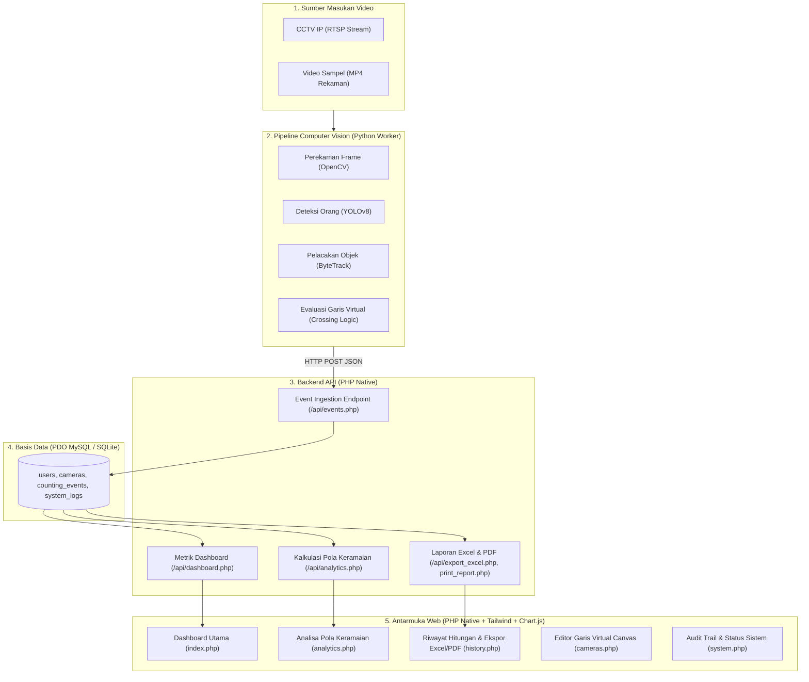

# Arsitektur Sistem — Ayam Bang Jungko

## Sistem Penghitungan Pengunjung untuk Analisa Pola Keramaian Berbasis CCTV

### 1. Gambaran Umum Arsitektur (Hybrid PHP Native + Python AI)

Sistem ini menerapkan arsitektur *hybrid CCTV analytics*:
- **Edge / Worker (Python)**: Inferensi video real-time (YOLOv8 + ByteTrack) membaca feed CCTV/video sampel dan mendeteksi penyeberangan garis virtual (crossing logic).
- **Web App & REST API (PHP Native)**: Menangani antarmuka web dashboard, kalkulasi analitik pola keramaian, ekspor laporan spreadsheet Excel (.xls) dan dokumen cetak/PDF, serta penyimpanan basis data terstruktur via PDO.

### 2. Keunggulan Arsitektur Ini
1. **Performa Tinggi**: Modul AI berbasis Python memanfaatkan GPU/CUDA dan PyTorch untuk kecepatan deteksi real-time.
2. **Ringan & Portabel**: Antarmuka web PHP Native tidak memerlukan kompilasi Node.js, `npm install`, atau dependencies besar; langsung dapat dijalankan di web server bawaan PHP (`php -S`) atau XAMPP.
3. **Privasi Pelanggan**: Sistem hanya mencatat koordinat lintasan (*centroid bounding box*) dan arah masuk/keluar, tanpa menyimpan data biometrik maupun rekaman wajah pengunjung.
