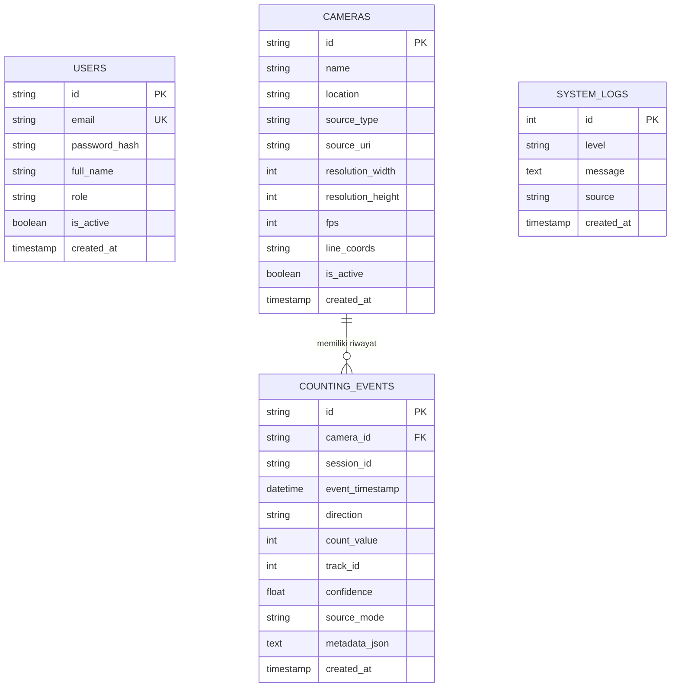

# Desain & Arsitektur Basis Data

## Sistem Penghitungan Pengunjung Ayam Bang Jungko (PHP Native & PDO)

### 1. Desain Relasional dan Skema Tabel

Basis data dirancang untuk mendukung penyimpanan data lalu lintas penyeberangan garis virtual secara efisien, menggunakan **PDO** yang kompatibel dengan **MySQL / MariaDB (XAMPP)** dan **SQLite**.

### 2. Penjelasan Tabel Utama

1. **`users`**: Menyimpan kredensial manajer operasional restoran. Sandi disimpan dalam bentuk hash aman (`password_hash` dengan algoritma BCRYPT).
2. **`cameras`**: Menyimpan konfigurasi kamera CCTV, resolusi, FPS, dan format JSON koordinat garis virtual penyeberangan P1 `(x1, y1)` dan P2 `(x2, y2)`.
3. **`counting_events`**: Menyimpan stempel waktu penyeberangan (*timestamp* WIB), arah (`IN` atau `OUT`), ID pelacakan unik ByteTrack (`track_id`), dan tingkat keyakinan deteksi (*confidence*).
4. **`system_logs`**: Mencatat audit trail operasional dan status komunikasi AI worker.
