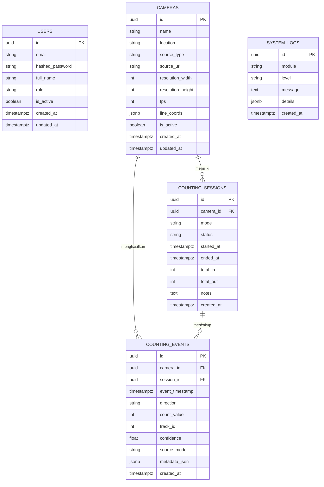

# Database Design & Architecture

## Sistem Penghitungan Pengunjung Ayam Bang Jungko

### 1. Desain Relasional dan Normalisasi

Sistem basis data dirancang menggunakan PostgreSQL dalam bentuk Normal Ketiga (3NF) guna menghindari anomali pembaruan (update anomalies), redundansi data, dan memastikan integritas data pengunjung yang akurat.

---

### 2. Detail Entitas

#### 2.1 `users`
Menyimpan kredensial operator dan manajer restoran Ayam Bang Jungko. Password disimpan menggunakan algoritma hashing aman (`bcrypt` atau `Argon2ID`). Akses REST API diamankan dengan JWT (JSON Web Token).

#### 2.2 `cameras`
Menyimpan konfigurasi sumber video (CCTV RTSP stream, webcam lokal, atau file rekaman video uji coba).
- Koordinat garis virtual crossing disimpan dalam format JSONB fleksibel (`x1`, `y1`, `x2`, `y2`, `direction_in`).
- Kredensial RTSP pada `source_uri` disamarkan (masked) sebelum dikirim ke antarmuka frontend untuk keamanan.

#### 2.3 `counting_sessions`
Mencatat riwayat sesi pemrosesan video secara persisten. Setiap kali worker computer vision mulai memproses video atau menerima stream, sebuah sesi dibuat untuk mengukur performa durasi dan akumulasi total masuk/keluar.

#### 2.4 `counting_events`
Tabel inti analitik pengunjung:
- `event_timestamp`: Waktu deteksi crossing.
- `direction`: `IN` (Pengunjung Masuk) atau `OUT` (Pengunjung Keluar).
- `count_value`: Nilai hitungan (default = 1). Mencegah double counting dengan validasi `track_id`.
- `track_id`: ID unik pelacakan dari ByteTrack pada sesi tersebut.
- `source_mode`: Label eksplisit `DEMO`, `VIDEO`, atau `LIVE` untuk memastikan data simulasi tidak tercampur diam-diam dengan data CCTV riil.

#### 2.5 `system_logs`
Menyimpan audit trail sistem untuk backend, API, database health check, dan worker computer vision.

---

### 3. Strategi Waktu & Timezone
- **Penyimpanan**: Seluruh kolom waktu menggunakan tipe PostgreSQL `TIMESTAMPTZ` (disimpan dalam UTC).
- **Penyajian**: REST API dan antarmuka frontend mengonversi dan menampilkan waktu dalam zona **Asia/Jakarta (WIB, UTC+7)** sesuai jam operasional Ayam Bang Jungko.

---

### 4. Strategi Pengindeksan (Indexing)
- `idx_counting_events_cam_ts`: Indeks majemuk `(camera_id, event_timestamp DESC)` untuk kueri agregasi per kamera dan rentang tanggal dengan performa cepat.
- `idx_counting_events_ts`: Pengurutan cepat riwayat penyeberangan (timeline table).
- `idx_counting_events_mode`: Membedakan agregasi data DEMO vs CCTV riil.
